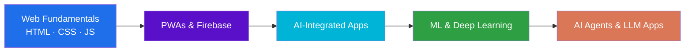

<div align="center">


<a href="https://github.com/Abdallah-Selmi221">
  
</a>

<br/>


<br/><br/>

<a href="https://portfolio-1-flax-three.vercel.app"></a>
<a href="https://linkedin.com/in/abdallah-selmi-abdallah"></a>
<a href="mailto:podep8166@gmail.com"></a>


</div>

<br/>

---

## 👨‍💻 About Me

```js
const abdallah = {
  role: "IT Student — Frontend & AI-Integrated Web Development",
  university: "Faculty of Computers and Information, Arish University",
  degree: "Bachelor of Information Technology (2024 – 2028)",
  location: "El-Arish, Egypt 🇪🇬",
  focus: ["Progressive Web Apps", "AI-Integrated Web Apps", "Applied Machine Learning"],
  currentlyLearning: ["Deeper web fundamentals", "AI Agents", "Deep Learning & Computer Vision"],
  achievements: [
    "🏆 1st Place — Damietta University AI Hackathon 2026",
    "🏆 1st Place — VOIS Smart Village technical team competition",
  ],
  funFact: "I use AI tools to move faster — from ideation to coding to testing ⚡",
};
```

> I build AI-integrated **Progressive Web Apps** and full-stack web applications, and I combine front-end engineering with cloud / networking fundamentals and applied machine learning. I learn by building — hands-on, under real deadlines.

---

## 🏆 Achievements

<div align="center">

| 🥇 | Achievement | When |
|:--:|:--|:--:|
| 🏆 | **1st Place Winner** — Damietta University AI Hackathon 2026 (Faculty of Computers and Artificial Intelligence) — won for technical execution, innovation, and presentation | 2026 |
| 🏆 | **1st Place** — Technical team competition, Vodafone Intelligent Solutions (VOIS) Smart Village visit | Aug 2026 |
| 🚀 | **Active Participant** — Egypt Cities Hackathon, Impact Edition 2026 (ICEALEX business incubator, Suez Canal cohort) | Oct 2026 |
| 💡 | **Participant** — InnovEgypt Program, Technology Innovation and Entrepreneurship Center (TIEC) | 2026 |

</div>

---

## 🚀 Featured Projects

### 📱 Ard Al-Fayrouz (أرض الفيروز) — PWA Super App &nbsp;🏆 *1st Place, Damietta University AI Hackathon 2026*

<div align="center">


</div>

- Architected and developed a **Progressive Web App (PWA) Super App** integrating a **Firebase real-time database**, **Google Maps API**, and **OpenRouteService** for AI-assisted navigation and location-based services.
- Led the **end-to-end build** — from UI/UX design through front-end implementation — as part of a university team, applying AI tools to accelerate ideation, coding, and testing under a competitive time constraint.
- Competed against multiple university teams through the **qualifying and final stages** and won **1st place** for technical execution, innovation, and presentation.

<br/>

### 🛒 E-Commerce Web App


- Engineered a complete web application for **business management and inventory display**, integrating **Local Storage** systems and **automated messaging tools** to streamline communication and user-interface management.

<br/>

### 📝 Documentation & Presentation Design


- Designed and formatted **academic documents, healthcare evaluation sheets, and complete presentations** for academic bodies using the Microsoft Office suite.

---

## 🛠️ Tech Stack

> **Honest skill levels:** I'm comfortable *understanding and building* with the web basics, but I'm still growing toward mastery — I'd rather be real about it than oversell. 🌱

### 🌐 Web & App Development


### 🤖 Machine Learning & Data Science


`Python & NumPy for AI` · `Probability & Statistics` · `Linear Algebra for ML` · `Data Exploration & Preparation` · `Machine Learning Foundations` · `Neural Networks & Deep Learning` · `Computer Vision`

### 🧠 Artificial Intelligence


### 🌐 Networking, Cloud & IT Systems


### 📊 Office Productivity


---

## 🎓 Certifications & Training

<details open>
<summary><b>🌐 Networking — Cisco Networking Academy</b></summary>
<br/>

| Certificate | Issuer | Date |
|:--|:--|:--:|
| Getting Started with Cisco Packet Tracer |  | Jul 2026 |
| Networking Basics |  | 2026 |
| Digital Safety and Security Awareness |  | Sep 2026 |

</details>

<details open>
<summary><b>🤖 Artificial Intelligence & Machine Learning</b></summary>
<br/>

| Certificate | Issuer | Date |
|:--|:--|:--:|
| **AI and Machine Learning Foundations — Level 1 (135 hrs)**<br/><sub>Python & NumPy for AI · Probability & Statistics · Linear Algebra · Data Exploration · Machine Learning · Neural Networks & Deep Learning · Final Project</sub> |  | Sep 2026 |
| Intro to Deep Learning |  | Sep 2026 |
| Computer Vision |  | Sep 2026 |
| What Is Generative AI? |  | Aug 2026 |
| Introduction to Large Language Models |  | Aug 2026 |
| Agent Fundamentals |  | 2026 |
| Enterprise Agents and Use Cases |  | 2026 |
| Create Your First Gemini Enterprise Application |  | 2026 |
| Claude Code in Action |  | 2026 |

</details>

<details open>
<summary><b>💼 Professional Development</b></summary>
<br/>

| Program | Issuer | Date |
|:--|:--|:--:|
| Preparation Skills for the Labor Market: CV Writing, Interview Skills, Career Development | ITIDA — Ministry of Communications and Information Technology, in collaboration with Arish University | Dec 2026 |

</details>

<details open>
<summary><b>🚀 Training & Programs</b></summary>
<br/>

| Program | Organizer | Year |
|:--|:--|:--:|
| InnovEgypt Program | Technology Innovation and Entrepreneurship Center (TIEC) | 2026 |

</details>

---

## 📊 GitHub Stats

<div align="center">


<br/>


<br/>


<br/><br/>


</div>

---

## 🧭 Roadmap



---

## 🤝 Let's Connect

<div align="center">

<a href="https://portfolio-1-flax-three.vercel.app"></a>
<a href="https://linkedin.com/in/abdallah-selmi-abdallah"></a>
<a href="https://github.com/Abdallah-Selmi221"></a>
<a href="mailto:podep8166@gmail.com"></a>

<br/><br/>

<i>"Build fast, learn faster."</i> ⚡


</div>
