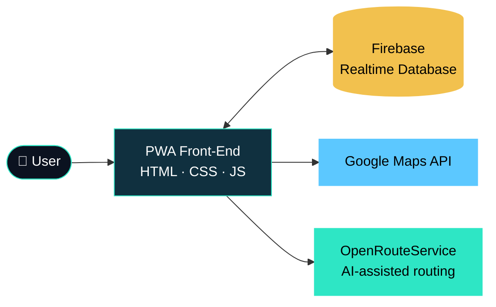
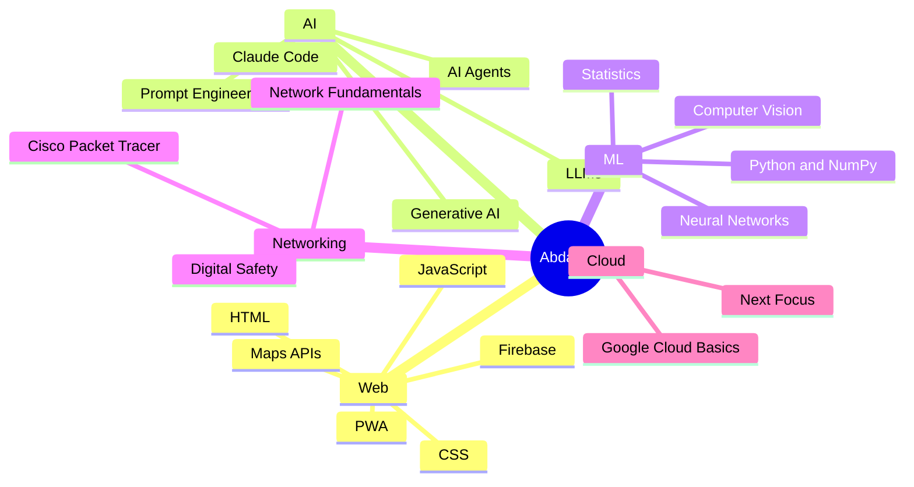
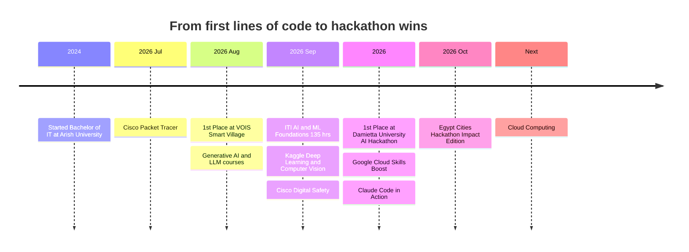
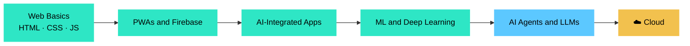
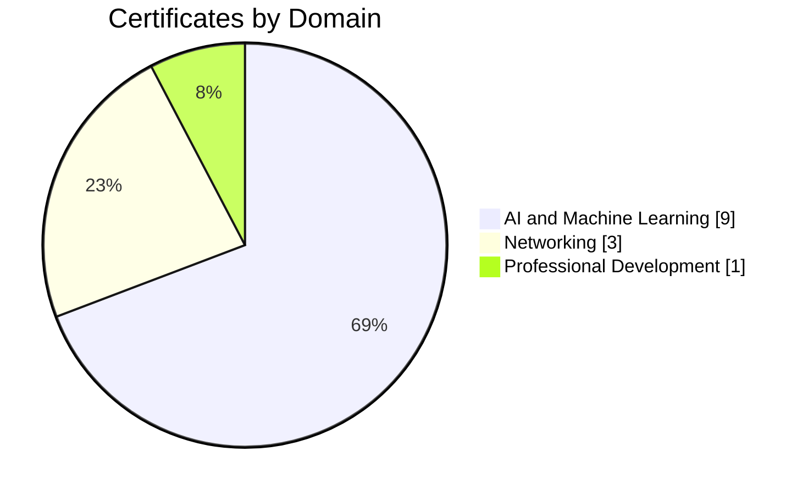

<div align="center">


<br/>


<br/><br/>

📍 El-Arish, Egypt 🇪🇬 &nbsp;|&nbsp; 🎓 Arish University, Bachelor of IT (2024 – 2028) &nbsp;|&nbsp; 🤝 Open to internships and collaborations

<br/>

[🌐 **Portfolio**](https://portfolio-1-flax-three.vercel.app) &nbsp;·&nbsp; [💼 **LinkedIn**](https://linkedin.com/in/abdallah-selmi-abdallah) &nbsp;·&nbsp; [📧 **Email**](mailto:podep8166@gmail.com) &nbsp;·&nbsp; [🐙 **GitHub**](https://github.com/Abdallah-Selmi221)

</div>


<h2 align="center">⚡ At a Glance</h2>


<h2 align="center">👨‍💻 About Me</h2>

<div align="center">

</div>

<br/>

```js
const abdallah = {
  role: "IT Student — Frontend & AI-Integrated Web Development",
  location: "El-Arish, Egypt 🇪🇬",
  code: ["HTML", "CSS", "JavaScript", "Python", "C++ (basics)"],
  workflow: "Idea → Design → Build with AI assistance → Test → Ship",
  wins: ["Damietta University AI Hackathon 2026", "VOIS Smart Village Competition"],
  nextFocus: "Cloud Computing ☁️",
};
```


<h2 align="center">🎯 Current Focus</h2>

<table align="center">
  <tr>
    <td align="center" width="280">
      <h3>🌱 JavaScript</h3>
      <sub>Writing it regularly and sharpening the fundamentals beyond AI-assisted coding.</sub>
    </td>
    <td align="center" width="280">
      <h3>🤖 AI and Agents</h3>
      <sub>LLMs, AI agents on Google Cloud, and agentic coding with Claude Code.</sub>
    </td>
    <td align="center" width="280">
      <h3>☁️ Cloud (Next)</h3>
      <sub>Moving from cloud basics to deploying real apps on cloud platforms.</sub>
    </td>
  </tr>
</table>


<h2 align="center">🏆 Achievements</h2>

| | Achievement | When |
|:--:|:--|:--:|
| 🥇 | **1st Place** — Damietta University AI Hackathon 2026 (Faculty of Computers and Artificial Intelligence), for technical execution, innovation and presentation | 2026 |
| 🥇 | **1st Place** — Technical team competition, Vodafone Intelligent Solutions (VOIS) Smart Village visit | Aug 2026 |
| 🚀 | **Active Participant** — Egypt Cities Hackathon, Impact Edition 2026 (ICEALEX business incubator, Suez Canal cohort) | Oct 2026 |
| 💡 | **Participant** — InnovEgypt Program, Technology Innovation and Entrepreneurship Center (TIEC) | 2026 |


<h2 align="center">🚀 Featured Projects</h2>

<h3 align="center">📱 Ard Al-Fayrouz (أرض الفيروز) — PWA Super App</h3>

<p align="center"><b>🏆 1st Place — Damietta University AI Hackathon 2026</b></p>

<p align="center">
<code>PWA</code> · <code>Firebase Realtime Database</code> · <code>Google Maps API</code> · <code>OpenRouteService</code> · <code>HTML</code> · <code>CSS</code> · <code>JavaScript</code>
</p>

- Architected and developed a **Progressive Web App Super App** integrating a **Firebase real-time database**, **Google Maps API** and **OpenRouteService** for AI-assisted navigation and location-based services.
- Spearheaded the **end-to-end build**, from UI/UX design to front-end implementation, as part of a university team, using AI tools to accelerate ideation, coding and testing under a competitive time constraint.
- Competed against multiple university teams through the **qualifying and final stages** and won **1st place**.

**How it fits together:**



<br/>

<table>
  <tr>
    <td width="50%" valign="top">
      <h3>🛒 E-Commerce Web App</h3>
      <code>HTML</code> · <code>CSS</code> · <code>JavaScript</code> · <code>Local Storage</code>
      <br/><br/>
      A complete web application for <b>business management and inventory display</b>, with Local Storage systems and automated messaging tools to streamline communication and interface management.
    </td>
    <td width="50%" valign="top">
      <h3>📝 Documentation and Presentations</h3>
      <code>Word</code> · <code>PowerPoint</code> · <code>Excel</code>
      <br/><br/>
      Designed and formatted <b>academic documents, healthcare evaluation sheets and complete presentations</b> for academic bodies, with a clear, well-organized visual structure.
    </td>
  </tr>
</table>


<h2 align="center">🛠️ Tech Stack</h2>

<div align="center">

</div>

<br/>

<h3 align="center">📈 Skill Levels</h3>

<div align="center">

</div>

<br/>

<h3 align="center">🧩 Skill Map</h3>




<h2 align="center">🧭 My Journey</h2>



<h3 align="center">🗺️ Learning Path</h3>




<h2 align="center">🎓 Certifications and Training</h2>



<details open>
<summary><b>🌐 Networking — Cisco Networking Academy</b></summary>
<br/>

| Certificate | Issuer | Date |
|:--|:--|:--:|
| Getting Started with Cisco Packet Tracer | Cisco Networking Academy | Jul 2026 |
| Networking Basics | Cisco Networking Academy | 2026 |
| Digital Safety and Security Awareness | Cisco Networking Academy | Sep 2026 |

</details>

<details open>
<summary><b>🤖 Artificial Intelligence and Machine Learning</b></summary>
<br/>

| Certificate | Issuer | Date |
|:--|:--|:--:|
| **AI and Machine Learning Foundations, Level 1 (135 hrs)**<br/><sub>Python & NumPy for AI · Probability & Statistics · Linear Algebra · Data Exploration · Machine Learning · Neural Networks & Deep Learning · Final Project</sub> | Information Technology Institute (ITI) | Sep 2026 |
| Intro to Deep Learning | Kaggle | Sep 2026 |
| Computer Vision | Kaggle | Sep 2026 |
| What Is Generative AI? | LinkedIn Learning | Aug 2026 |
| Introduction to Large Language Models | Simplilearn SkillUp, powered by Google Cloud | Aug 2026 |
| Agent Fundamentals | Google Cloud Skills Boost | 2026 |
| Enterprise Agents and Use Cases | Google Cloud Skills Boost | 2026 |
| Create Your First Gemini Enterprise Application | Google Cloud Skills Boost | 2026 |
| Claude Code in Action | Anthropic | 2026 |

</details>

<details open>
<summary><b>💼 Professional Development</b></summary>
<br/>

| Program | Issuer | Date |
|:--|:--|:--:|
| Preparation Skills for the Labor Market: CV Writing, Interview Skills, Career Development | ITIDA, Ministry of Communications and Information Technology, in collaboration with Arish University | Dec 2026 |

</details>

<details open>
<summary><b>🚀 Training and Programs</b></summary>
<br/>

| Program | Organizer | Year |
|:--|:--|:--:|
| InnovEgypt Program | Technology Innovation and Entrepreneurship Center (TIEC) | 2026 |

</details>


<h2 align="center">🤝 Let's Connect</h2>

<div align="center">

[🌐 Portfolio](https://portfolio-1-flax-three.vercel.app) &nbsp;·&nbsp; [💼 LinkedIn](https://linkedin.com/in/abdallah-selmi-abdallah) &nbsp;·&nbsp; [📧 podep8166@gmail.com](mailto:podep8166@gmail.com) &nbsp;·&nbsp; [🐙 GitHub](https://github.com/Abdallah-Selmi221)

<br/>


</div>
